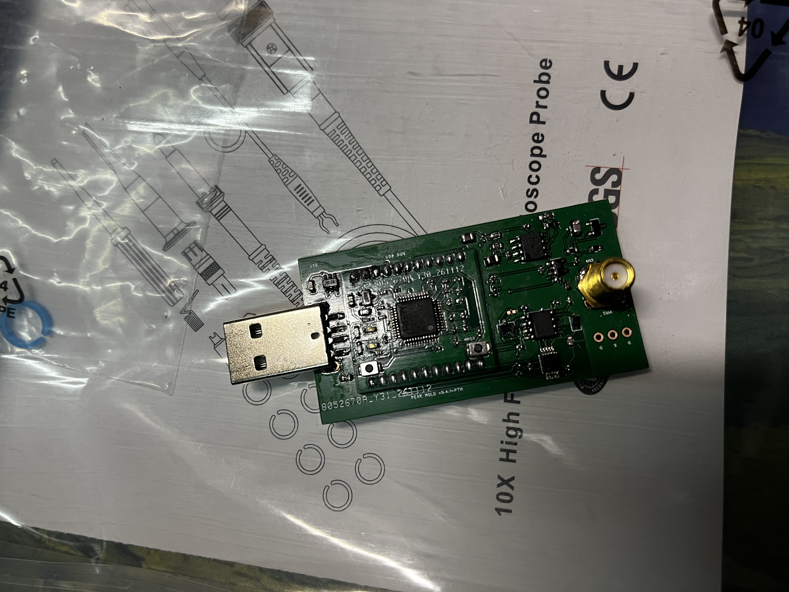
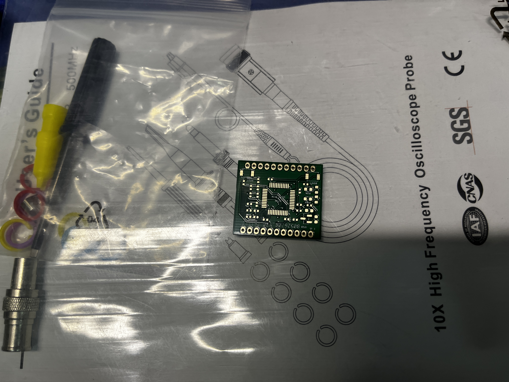
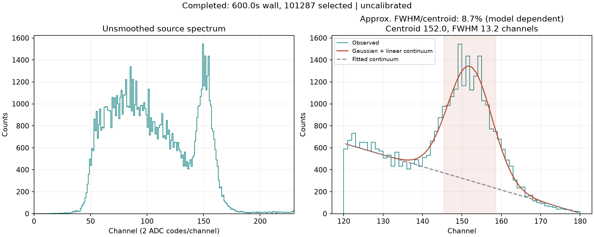
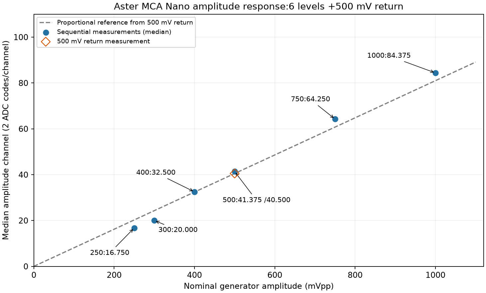
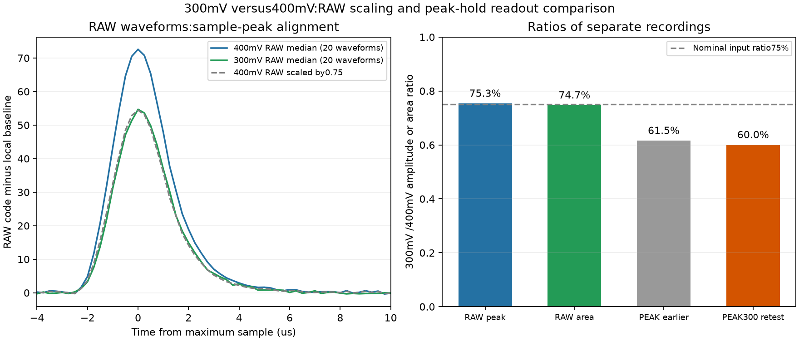
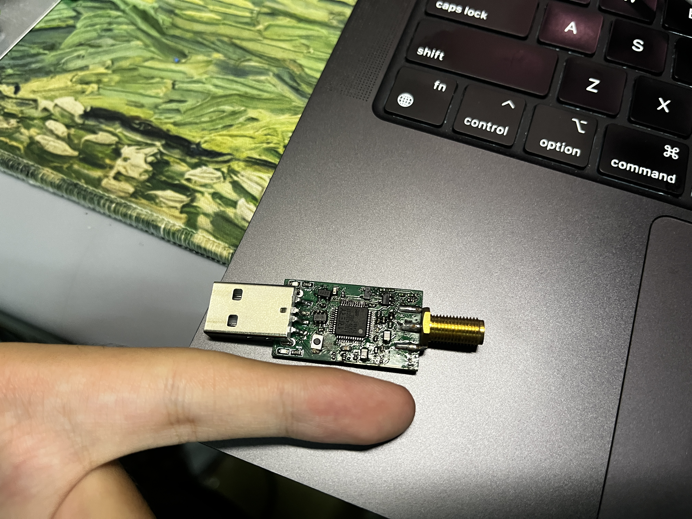
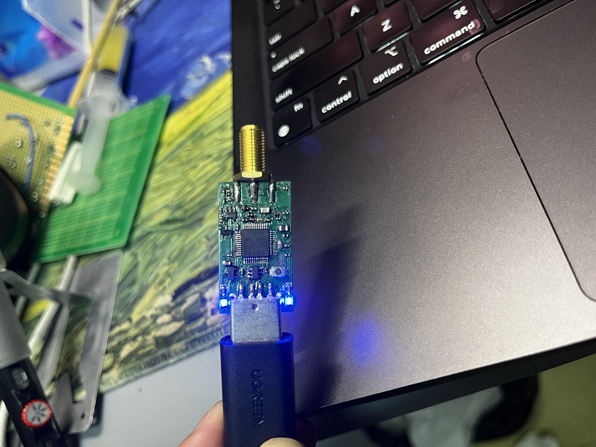
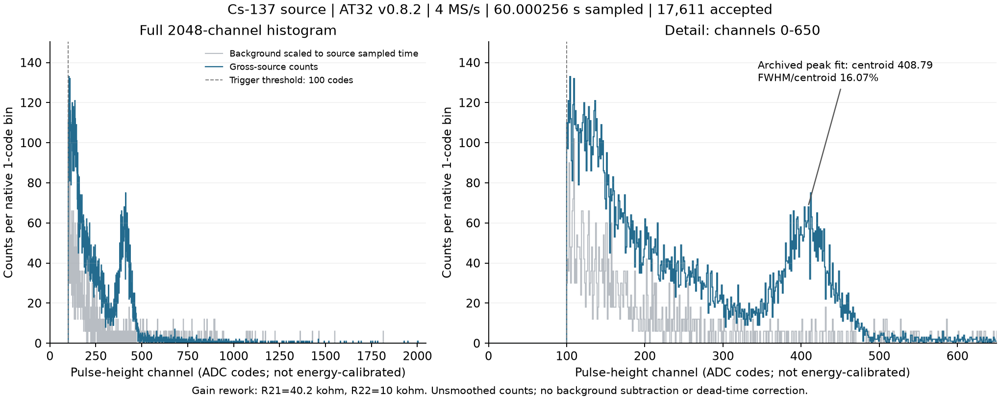
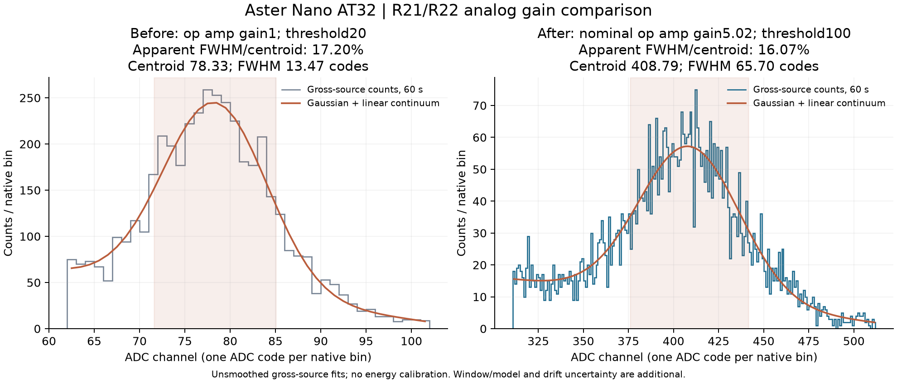

# Aster MCA Nano

[中文](README.md) | English

A low-cost USB multichannel pulse-height analyzer project with separate AT32 and CH32 development tracks. It accepts the low-voltage output of a detector's existing amplifier/shaper. The current AT32 bench uses a **v0.4.1 PTH core plus peak-hold carrier**, with event readout and host-side binning, display and storage. The earlier v0.3 32 × 18 mm single-board design remains archived.

Nano is the MCU-based subproject of the [Aster MCA family](../README.md).

## Development tracks

| Track | Status | Documentation |
|---|---|---|
| **AT32F423** | v0.4.1 peak-hold bench; low-level bias unresolved; v0.3 measurements archived | [AT32 guide](docs/at32/README.en.md) |
| **CH32X033F8P6** | **Baseline drift and abnormal spikes are still under investigation.** Analog-chain diagnostics are available; reliable spectroscopy has not been validated. | [CH32 status and hardware](docs/ch32/README.md) |

2026-11-19 checkpoint: [v0.4.1 PTH core + peak-hold bench results](measurements/2026-11-18-peakhold/README.en.md). Current bench firmware: fast.7; low-amplitude bias remains unresolved. The 600-second Cs result of 8.67% is an uncalibrated channel-domain ratio. The v0.3 spectra, cost and desktop protocol below are retained as history.

This directory is maintained at `Aster-MCA/nano/`, with separate documentation and firmware directories for AT32 and CH32. The original Nano main-branch history was imported without squashing; the former repository retains historical entry points. See the [migration record](docs/repository-migration-2026-10-21.md). The v0.3 documentation dates from 2026-10-21; see the 2026-11-19 checkpoint above for current bench status.

## AT32 v0.4.1 photos, BOM and measurements

  
  

The photos show the assembled board pair and a bare core PCB, respectively. Core: **26 × 23 mm**; carrier: **60 × 32 mm**; board thickness: 1.6 mm. The 22-hole interface has 2.0 mm pitch and 0.8 mm drills. The design uses AT32F423CCT7, TLV9062, OPA2356, TMUX1136 and TLV3201. Published photos retain original pixels, ICC color information and display orientation while removing location and other personal metadata; see [photo provenance](docs/at32/photos/peakhold-photo-provenance.json).

- **[Combined BOM and assembly guide](docs/at32/peakhold-assembly/README.en.md)**: [CSV](docs/at32/peakhold-assembly/BOM-v0.4.1-bench.csv) · [Excel](docs/at32/peakhold-assembly/BOM-v0.4.1-bench.xlsx), one core plus one carrier, with recorded LCSC numbers.
- **[Errata and bench rework](docs/at32/peakhold-assembly/errata.en.md)**: reference/pin-1 markings, D11 pads, the single 10 kΩ R105 replacement, fitted 100 pF C101 and unresolved low-level bias.
- [Core placement aid](docs/at32/peakhold-assembly/core-locator.png) · [Carrier placement aid](docs/at32/peakhold-assembly/carrier-locator.png) · [Schematics, Gerbers and native CAD](hardware/at32-v0.4.1-pth/README.md) · [fast.7 firmware](firmware/at32-peakhold-fast7).

### Ten-minute cesium spectrum

Approximately 600 seconds, with 101,287 events used in the analysis. Centroid: 152.012 channels; FWHM: 13.173 channels; **channel-domain ratio: 8.67%**. Fit-window sensitivity is about 8.39–9.07%, with model mismatch. Energy calibration is incomplete; this is not a validated calibrated resolution at 662 keV.

### Fixed-pulse response and amplitude bias

The test negative pulse is about 4 µs wide overall. For 300/400 mV inputs, RAW peak/area ratios are about 75.3%/74.7%, while held-amplitude ratios are about 60–61.5%. Low-level bias remains unresolved. The [full measurement record, plots, raw data and offline checks](measurements/2026-11-18-peakhold/README.en.md) also cover wait deadlines, centroid drift and EARLY/LATE timing comparisons.

## Archived AT32 v0.3 prototype

  
  

The photographed prototype uses an **AT32F423CCT7**, a **TLV9061** external op amp, a USB-A male connector and an SMA female connector. The PCB is 1.6 mm thick. Two blue LEDs indicate power and operation. Published photographs retain the original image pixels and display orientation, with location and other personal metadata removed.

## Archived AT32 v0.3 configuration

| Item | Configuration |
|---|---|
| PCB | v0.3, 32 × 18 mm; original design lists CBT7, tested hardware uses CCT7 |
| Analog rework | R21 = 40.2 kΩ, R22 = 10 kΩ; nominal U3 gain 5.02 |
| Firmware | **v0.8.2**: [source](firmware/at32-peak-scope), [validated binary](outputs/Aster-MCA-Nano-AT32-波形诊断-v0.8.2-20261018/aster-at32-peak-v0.8.2.bin) |
| Spectrum acquisition | 4 MS/s, 12-bit ADC; negative-pulse sampled-peak extraction; 2048 on-board bins; stop at the requested duration, then transfer the final histogram |
| Trigger threshold | **100 ADC codes for the reworked board**; historical unity-op-amp-gain configuration used 20 |
| Diagnostic waveforms | Idle-only captures of 4096 samples / 1.024 ms, uploaded after sampling stops; gaps exist between segments |
| Desktop software | macOS native app v0.6.1, [source and packager](firmware/at32-continuous/desktop); browser development UI also available |

The desktop UI currently restores a threshold of 20 on reconnect. **Set it to 100 for the reworked board.** The normal spectrum contains only the final histogram; it cannot be used to repeat event-level digital shaping after acquisition.

## Archived cesium-source spectra

Blue shows unsmoothed gross-source counts; gray shows background scaled to the source sampled duration, without subtraction. The left panel covers all 2048 channels, and the right panel shows channels 0–650. The original gain-comparison peak fits follow below.

| Gross-source spectrum, 60 s | Before rework | After rework |
|---|---:|---:|
| Firmware | v0.8.0 | v0.8.2, same integer peak engine |
| Nominal op-amp gain / threshold | 1 / 20 codes | 5.02 / 100 codes |
| Accepted events | 15,896 | 17,611 |
| Peak centroid, ADC codes | 78.33 | 408.79 |
| FWHM / centroid | 17.20% | **16.07%** |

The plots use channel / ADC-code coordinates, without multipoint energy calibration. Fits use a bin-integrated Gaussian plus a nonnegative linear continuum on unsmoothed gross-source counts, rather than background-subtracted data. The post-rework fit varies from about 15.36% to 16.96% with the fit window. The model-conditional 95% interval for the after-minus-before change is −2.50 to +0.33 percentage points. A resolution improvement has **not** been established, and these results do not establish the detector's intrinsic resolution.

The latest 60.000256 s acquisition accepted 17,611 events and processed all 58,594 DMA blocks, with no reported device error or ADC overflow. This validates that recorded run; it does not establish performance over every input rate.

- [Latest native 2048-channel spectrum CSV](outputs/Aster-MCA-Nano-AT32-增益5倍实测-20261018/Cs-source-60s-2048ch.csv) and [metadata](outputs/Aster-MCA-Nano-AT32-增益5倍实测-20261018/Cs-source-60s-2048ch-metadata.json).
- [Source/background histograms, finite raw waveforms and fits](outputs/Aster-MCA-Nano-AT32-增益5倍实测-20261018); [detailed checkpoint](docs/2026-10-18-checkpoint.md).
- [Earlier 10-minute v0.6.3 cesium spectrum](outputs/Aster-MCA-Nano-AT32-v0.6.3-铯源10分钟分辨率-20261016/铯源谱与分辨率拟合.png), retained as history. Its integral estimator and configuration differ from the current peak mode.

## AT32 v0.3 single-board cost

**Priced subtotal: approximately CNY 17.86 per board, plus the actual USB-A connector, SMA connector and two stock LEDs.**

| Item | CNY per board |
|---|---:|
| PCB, project-specified cost | 4.00 |
| AT32 MCU, project-specified cost | 5.00 |
| Other quoted parts, current reworked population | 8.855465 |
| **Priced subtotal** | **17.855465 ≈ 17.86** |
| USB-A, SMA, LED1/LED2 | Actual prices unavailable; excluded |

Other component prices come from the project's **2026-10-10 LCSC quotation**, multiplied by fitted single-board quantities. They are historical costs, not current retail quotes. The calculation does not allocate all minimum-order stock or spares to a single board. Shipping, assembly labour, enclosure and detector electronics are excluded. See the bilingual [itemized cost and part numbers](docs/at32/cost.md) and [price inputs](docs/at32/cost-inputs.json).

## Schematics, Gerbers and assembly

| Download | AT32 v0.3 | CH32 v0.3 |
|---|---|---|
| Schematic PDF | [AT32 schematic](outputs/Aster-MCA-Nano-AT32-v0.3-USB-A-LED/Aster-MCA-Nano-AT32-v0.3-USB-A-LED-Schematic.pdf) | [CH32 schematic](outputs/Aster-MCA-Nano-CH32-v0.3-USB-A-LED/Aster-MCA-Nano-CH32-v0.3-USB-A-LED-Schematic.pdf) |
| Gerber ZIP | [AT32 Gerbers](outputs/Aster-MCA-Nano-AT32-v0.3-USB-A-LED/Aster-MCA-Nano-AT32-v0.3-USB-A-LED-Gerber.zip) | [CH32 Gerbers](outputs/Aster-MCA-Nano-CH32-v0.3-USB-A-LED/Aster-MCA-Nano-CH32-v0.3-USB-A-LED-Gerber.zip) |
| EasyEDA project, BOM and board views | [AT32 hardware package](outputs/Aster-MCA-Nano-AT32-v0.3-USB-A-LED) | [CH32 hardware package](outputs/Aster-MCA-Nano-CH32-v0.3-USB-A-LED) |
| Hand-assembly reference | [AT32 assembly](outputs/Aster-MCA-Nano-AT32-v0.3-焊接对照) | [CH32 assembly](outputs/Aster-MCA-Nano-CH32-v0.3-焊接对照) |

The original v0.3 schematic/BOM is archived unchanged: R21 = 0 Ω and R22 = DNP. Apply the documented [R21/R22 gain rework](outputs/Aster-MCA-Nano-AT32-增益改焊-20261018) to reproduce current AT32 measurements. The historical CH32 removal of C9 was a diagnostic change and must not be copied to AT32. Match connector substitutes to the footprint and actual PCB thickness; the externally sourced connectors in the photographs are not confirmed to be the original BOM part numbers.

The [historical paired-board panel](outputs/Aster-MCA-Nano-v0.3.1-SlotCut-Bridge2p5-32x38) was rejected by the fabricator for containing two designs in one file. Use the two independent single-board Gerber packages above.

## Build, run and reproduce

See the [development guide](docs/development.md) for firmware builds, native desktop packaging, offline analysis and archive verification. The original ARM toolchain and AT32 SDK are pinned there. `work/`, third-party toolchains, virtual environments and temporary captures are not committed.

Historical v0.7.x waveform-streaming experiments failed sustained processing with real pulses. v0.8.1 RAW capture was rejected after ADC overflow. Neither is the current acquisition release. The v0.8.2 flasher is a guarded historical updater, not an arbitrary blank-chip installer; see the [AT32 guide](docs/at32/README.en.md).

## Licensing

Nano project-authored material, including hardware designs, is licensed under [MIT](LICENSE). Third-party material retains its own terms. Imported WCH SDK and startup code retain their original notices and WCH-microcontroller-only restrictions; see [third-party notices](THIRD_PARTY_NOTICES.md) and [SOURCE-NOTES](firmware/ch32-selftest-v0.3/SOURCE-NOTES.txt). Obtain the AT32 SDK and complete toolchains from their original sources.
