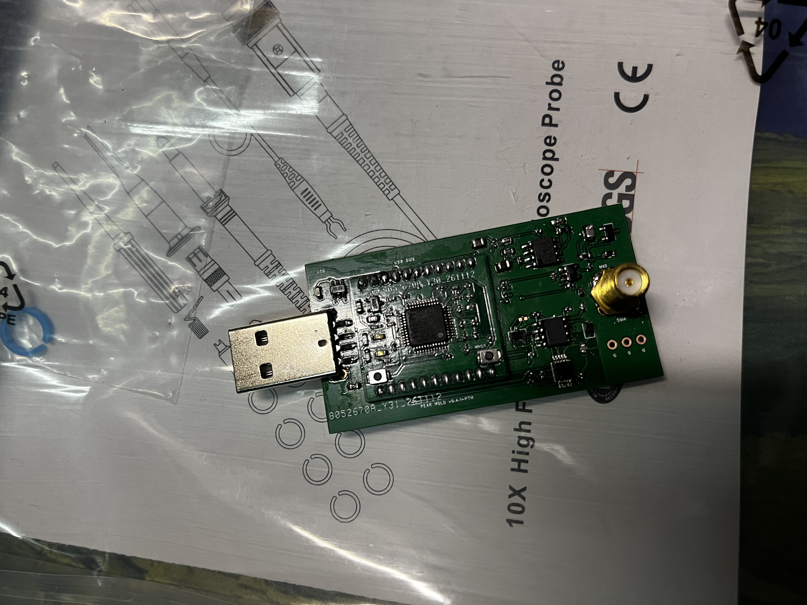
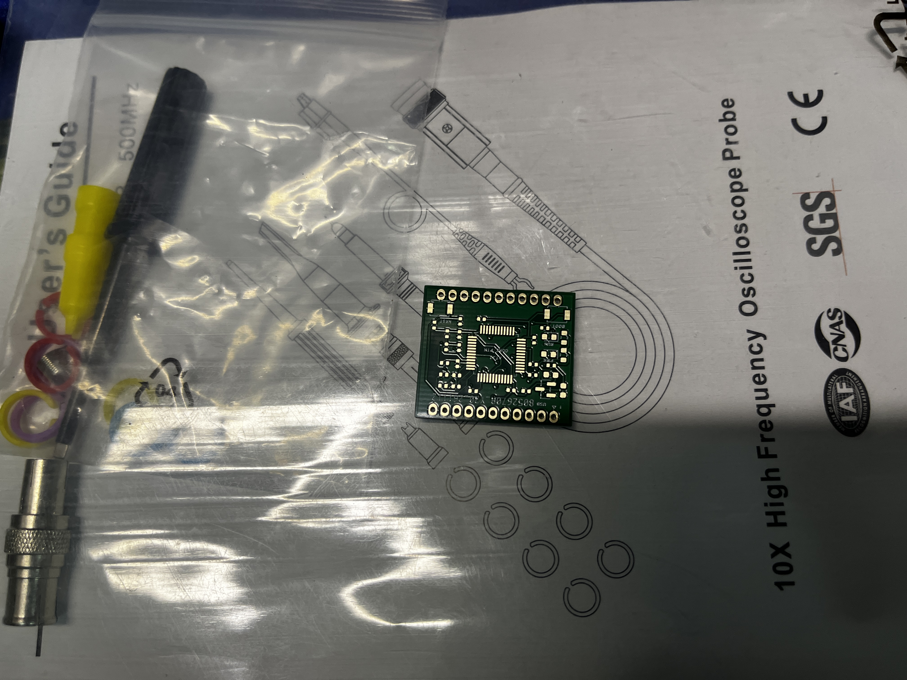
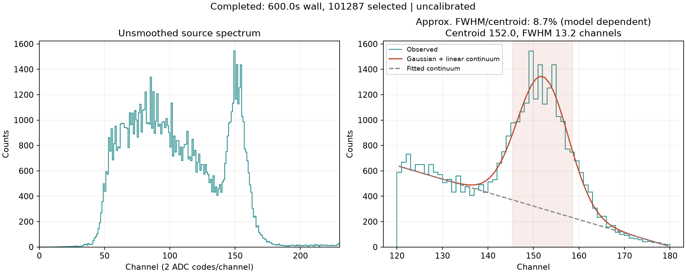
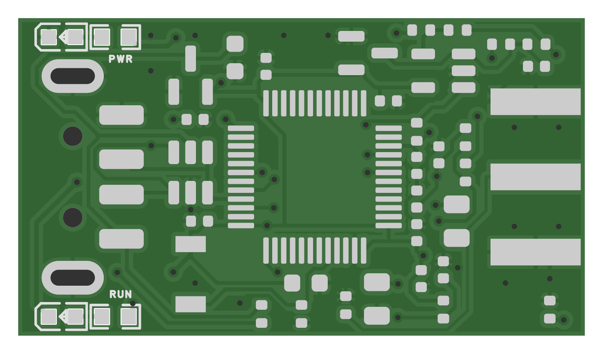
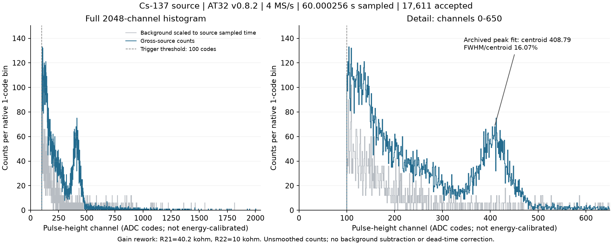
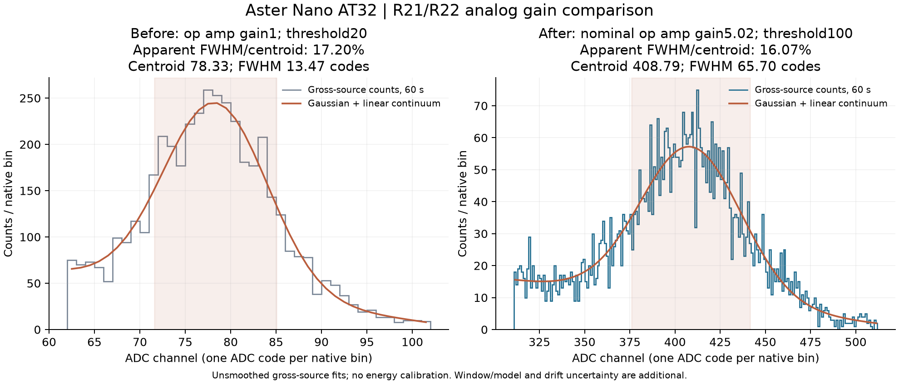

# AT32 开发主线

中文 | [English](README.en.md) | [项目首页](../../README.md)

下文归档实测配置为 **AT32F423CCT7 + TLV9061，v0.8.2，4 MS/s、2048 道**。接收已放大／整形的低压负脉冲；板上连续采样、取峰并累计直方图，到设定时间停止后回传一次谱。

最新：[2026-11-19 峰值保持检查点](../../measurements/2026-11-18-peakhold/README.md)，采用 v0.4.1 普通通孔核心＋峰保底板与 fast.7。已完成铯谱和固定脉冲诊断，低幅映射偏差尚未解决；[源码与已验证二进制](../../firmware/at32-peakhold-fast7)。下文保留 v0.3 的历史固件、谱和成本；旧桌面协议不适用于 fast.7。

## 当前 v0.4.1 双板资料





核心板 26 × 23 mm，底板 60 × 32 mm；[当前合并 BOM（CSV／Excel）与定位图](peakhold-assembly/README.md) · **[装配勘误与实测改焊](peakhold-assembly/errata.md)** · [原生工程、原理图和 Gerber](../../hardware/at32-v0.4.1-pth/README.md)。BOM 同时列出原设计与台架配置；R105 单颗 10 kΩ、C101 补装 100 pF 不会自动反映在冻结的 Gerber／CAD 内。



图中 8.67% 是未标定道数域 FWHM／峰位。低幅映射偏差仍待解决；[幅度扫描、RAW 及停止时机测量图](../../measurements/2026-11-18-peakhold/README.md)。下文为 v0.3 的历史说明。

## v0.3 硬件和装配归档



- [原理图 PDF](../../outputs/Aster-MCA-Nano-AT32-v0.3-USB-A-LED/Aster-MCA-Nano-AT32-v0.3-USB-A-LED-Schematic.pdf)
- [单板 Gerber ZIP](../../outputs/Aster-MCA-Nano-AT32-v0.3-USB-A-LED/Aster-MCA-Nano-AT32-v0.3-USB-A-LED-Gerber.zip)
- [立创 EDA 工程](../../outputs/Aster-MCA-Nano-AT32-v0.3-USB-A-LED/Aster-MCA-Nano-AT32-v0.3-USB-A-LED-EDA-VERIFIED.epro2)
- [按同种料合并的焊接位号与立创料号](../../outputs/Aster-MCA-Nano-AT32-v0.3-焊接对照/AT32-v0.3-合并取料与料号对照.csv)
- [R21/R22 改焊步骤、位置及用料](../../outputs/Aster-MCA-Nano-AT32-增益改焊-20261018)

板子 32 × 18 mm，实装厚度 1.6 mm，USB-A 公头、SMA 母座。原 v0.3 硬件包保留 R21 = 0 Ω、R22 不装，运放为单位增益缓冲。**当前实测替换为 R21 = 40.2 kΩ、补装 R22 = 10 kΩ，运放标称增益 5.02。** 当前成本也按改焊用量计算；原理图、Gerber 没有被悄悄改成另一版。

原工程使用 AT32F423CBT7，因备货改用 CCT7；本仓库的当前实测对象为 CCT7。SMA 接低压信号输出，不接探测器高压端。外购连接器需自行核对机械尺寸和 1.6 mm 板厚。

## v0.3 固件归档

| 内容 | 入口 |
|---|---|
| v0.3 已验证 v0.8.2 源码 | [at32-peak-scope](../../firmware/at32-peak-scope) |
| 已通过实物回读的 v0.8.2 BIN | [aster-at32-peak-v0.8.2.bin](../../outputs/Aster-MCA-Nano-AT32-波形诊断-v0.8.2-20261018/aster-at32-peak-v0.8.2.bin) |
| v0.8.2 协议、时序和诊断限制 | [固件说明](../../firmware/at32-peak-scope/README.txt) |
| 原整数取峰基线 v0.8.0 | [at32-peak](../../firmware/at32-peak) |
| 历史积分直方图基线 v0.6.3 | [at32-histogram](../../firmware/at32-histogram) |
| macOS 原生上位机及打包工具 | [desktop](../../firmware/at32-continuous/desktop) |

当前 BIN 为 24,004 字节，SHA256：

```text
40bdc400d1342128eccd6fee780109b5912d556745b524498abc322755162dea
```

CPU 144 MHz，ADC 72 MHz，内部 LDO 1.3 V；这些是该固件实测所用配置。固件默认门限仍为 20，**改焊板必须在上位机设为 100**，每次重连后重新确认。ADC 为 12 位，能谱为 2048 个脉冲幅度箱，每道 1 ADC 码。

`flash.py` 是受保护的历史升级工具：默认只接受已冻结的 v0.8.1 镜像身份后升级至 v0.8.2，`--restore-peak` 只接受 v0.8.2 并回退到 v0.8.0。它会备份 Flash／选项字节并回读检查，**不是任意空白芯片的首次烧录器**。v0.8.1 仅为迁移识别保留，不是推荐版本。首次下载应使用与芯片相符的官方 DFU/下载工具及给定 BIN；操作前断开 SMA，按住 BOOT 接通 USB 后松开。不要绕过工具的旧镜像检查。

## 谱、原始数据和复现





最新改焊后采样时长 60.000256 s，接受 17,611 事件，峰位 408.79 ADC 码，FWHM/峰位为 16.07%。未做多点能量标定；此比例不是已校准的能量分辨率承诺。窗口敏感性为约 15.36%–16.96%，改前改后差值的模型条件下 95% 区间包含零，增益改动尚未证明显著改善峰宽。

- [2048 道源谱、原始采集记录、本底及短波形](../../outputs/Aster-MCA-Nano-AT32-增益5倍实测-20261018)
- [拟合结果及窗口敏感性 JSON](../../outputs/Aster-MCA-Nano-AT32-增益5倍实测-20261018/gain-peak-fit-comparison.json)
- [旧增益 v0.8.0 的 60 秒源谱](../../outputs/Aster-MCA-Nano-AT32-取峰-v0.8.0-20261018/cs-source-60s-fit.png)
- [历史 v0.6.3 十分钟源谱](../../outputs/Aster-MCA-Nano-AT32-v0.6.3-铯源10分钟分辨率-20261016/铯源谱与分辨率拟合.png)
- [完整检查点和后续方向](../2026-10-18-checkpoint.md)

正常谱只有最终直方图，不能事后重做逐事件成形。RAW 诊断每段 4096 点，段间存在上传空隙；500 段只代表 0.512 s 真实采样，不能把墙钟时间当作采样时间。不要将历史 v0.7.x 实时传输实验或已失败的 v0.8.1 RAW 用作当前性能依据。

## 成本和开发

当前实测配置的已知材料价格合计 **¥17.855465，约 ¥17.86／板**，其中 PCB ¥4、AT32 ¥5，其余报价元件 ¥8.855465。外购 USB-A、SMA 和两颗库存 LED 未提供实际价格，另计；运费、人工、外壳与探头也不在其中。

- [逐项价格、料号、报价行号和口径](cost.md)
- [可复算价格输入](cost-inputs.json)
- [构建、上位机、离线研究和档案校验](../development.md)
- [实物照片](photos)
