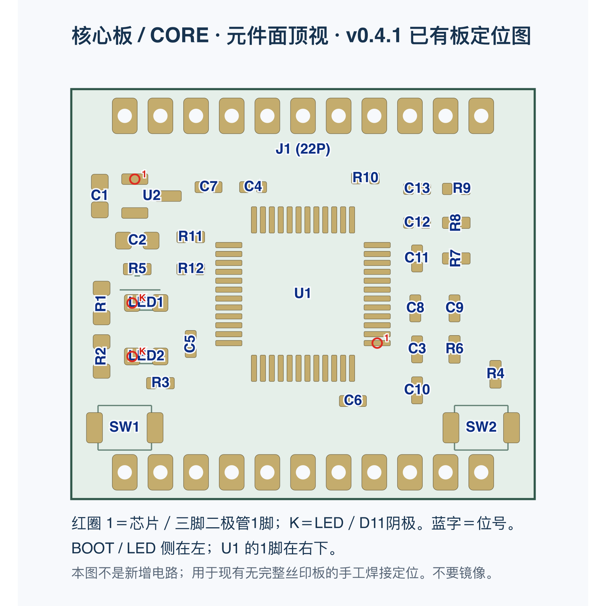
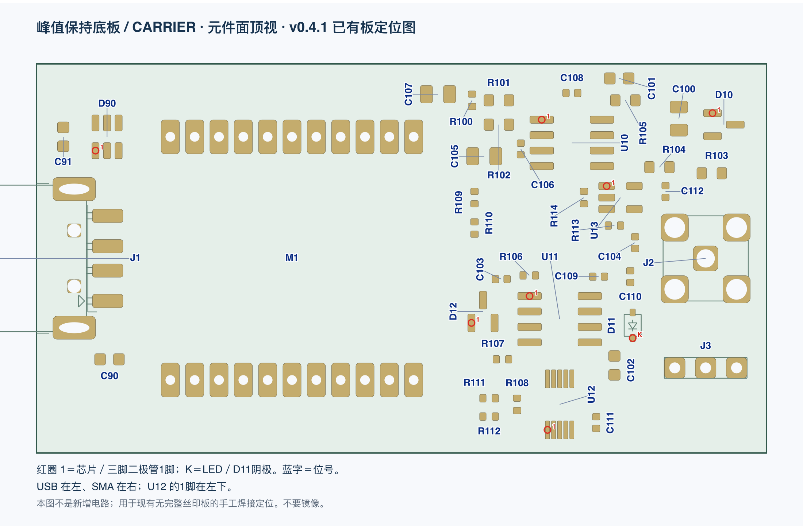

# v0.4.1 PTH core + peak-hold carrier: BOM and assembly

[中文](README.md) · English · [AT32 track](../README.en.md) · [Measurements](../../../measurements/2026-11-18-peakhold/README.en.md)

This list covers **one 26 × 23 mm core and one 60 × 32 mm carrier**. Quantities follow the default assembly record plus the confirmed R105/C101 bench rework. Optional parts remain separate; this is not a complete photo-derived inventory of the prototypes. Published 2026-11-19.

| Resource | Download and purpose |
|---|---|
| Combined CSV BOM | [BOM-v0.4.1-bench.csv](BOM-v0.4.1-bench.csv): references, per-set quantities, original and bench values, packages and recorded LCSC numbers |
| Excel BOM | [BOM-v0.4.1-bench.xlsx](BOM-v0.4.1-bench.xlsx): identical data; amber rows are reworked, gray rows are optional/DNP |
| Errata | [Assembly issues, rework and unresolved behavior](errata.en.md) |
| Placement aids | [Core](core-locator.png) · [Carrier](carrier-locator.png): component-side top views; do not mirror |
| Frozen hardware | [v0.4.1 native CAD, schematics and Gerbers](../../../hardware/at32-v0.4.1-pth/README.md) |
| Provenance | [BOM sources and coverage](BOM-provenance.json) · [Locator image sources](locator-provenance.json) |

The 44 grouped rows cover **74 native design references**, including DNP parts and board interfaces. References are qualified as `Core:` or `Carrier:` because the boards reuse names such as J1. The board interface uses **two 1×11 header strips, 2.0 mm pitch, 0.5 mm square pins**. Quantity is two strips for the complete board pair, not four. Other quantities are individual pieces; zero means DNP in the default configuration.

## Bench configuration

| Carrier reference | Original record | Reproduction configuration | Part number |
|---|---|---|---|
| R104 | 49.9 kΩ, 0.1%, 0603 | Retain 49.9 kΩ | C491136 |
| R105 | 49.9 kΩ, 0.1%, 0603 | **Replace with one 10 kΩ resistor**, not a parallel addition | Actual tolerance, manufacturer and part number unrecorded; blank |
| C101 | DNP, 1–4.7 pF tuning footprint, 0603 | **Fit 100 pF** | Actual dielectric and manufacturer unrecorded; prefer C0G/NP0 for reproduction; blank |
| C102 | 470 pF, C0G, 0603 | Retain 470 pF | C36252 |

Core C12 is **100 pF, 0402, C1546**; its part number must not be copied to carrier C101, which uses 0603. C100 is **33 nF, C0G, 0805, C76628**. All 0402/0603/0805 package sizes use imperial notation.

OPA2356AIDR is an externally sourced SOIC-8. Actual LCSC numbers are unavailable for it, the AT32F423CCT7, blue LEDs, external USB-A/SMA/header substitutes and the two reworked parts. Their fields remain blank. Recorded historical LCSC numbers do not imply current availability, prices or validated alternatives. Personal stock, order quantities and shipping details are excluded.

SW2, C103 and J3 require no extra fitted component in the default list. Add one B3U-1000P (C231329) if fitting the optional SW2 reset switch. The v0.3 TLV9061 board BOM and costs are historical and do not describe this board pair.

## Hand-assembly views

Red `1` circles identify IC/three-pin-diode pin 1; `K` identifies LED/D11 cathodes. In the carrier view USB is left and SMA is right. The core BOOT/LED side faces USB. Photographs may be rotated; follow the drawings and pad nets. These are assembly aids for existing boards. The original image folder's v0.4.2 name **does not identify a released v0.4.2 manufacturing package with corrected silkscreen or pads**.

The original [core BOM](../../../hardware/at32-v0.4-peakhold/design/core/BOM.csv) and [carrier BOM](../../../hardware/at32-v0.4-peakhold/design/carrier/BOM.csv) retain their design-time values. This list is a bench-rework appendix; the native CAD and Gerbers have not been overwritten.
