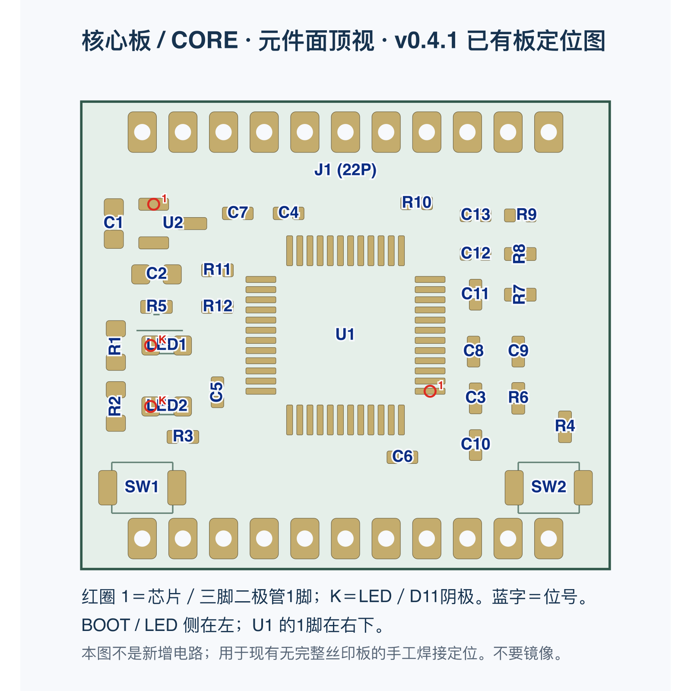
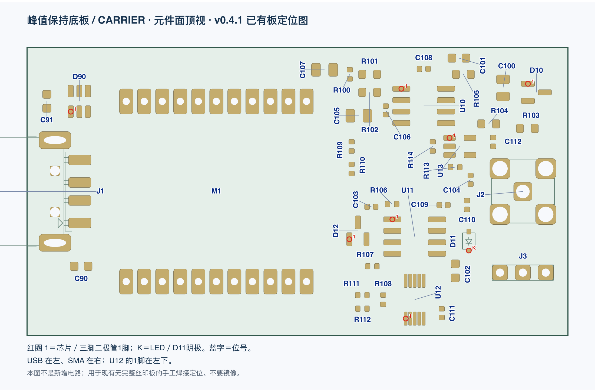

# v0.4.1 通孔核心＋峰值保持底板：BOM 与装配

中文 · [English](README.en.md) · [AT32 主线](../README.md) · [测量结果](../../../measurements/2026-11-18-peakhold/README.md)

本清单对应 **一块 26 × 23 mm 核心板＋一块 60 × 32 mm 底板**。数量沿用装配记录的默认配置，并加入已确认的 R105、C101 改焊；可选件单列，不能据此推断照片中每个可选位置的实际装配状态。整理日期：2026-11-19。

| 资料 | 下载与用途 |
|---|---|
| 合并 BOM，CSV | [BOM-v0.4.1-bench.csv](BOM-v0.4.1-bench.csv)，含核心板／底板位号、单套用量、原设计值、台架配置、封装和已知立创料号 |
| 合并 BOM，Excel | [BOM-v0.4.1-bench.xlsx](BOM-v0.4.1-bench.xlsx)，同一份数据；黄色行为改焊，灰色行为可选不装 |
| 勘误 | [已知装配问题、改焊和待解决问题](errata.md) |
| 定位图 | [核心板](core-locator.png) · [底板](carrier-locator.png)，元件面顶视，不镜像 |
| 冻结硬件文件 | [v0.4.1 原生工程、原理图、Gerber](../../../hardware/at32-v0.4.1-pth/README.md) |
| 数据来源 | [BOM 来源与核对范围](BOM-provenance.json) · [定位图来源](locator-provenance.json) |

44 行按同种料合并，覆盖原生网表的 **74 个设计位号**，其中包括不装件及板间接口。核心板和底板可能都有 J1 等同名位号，清单用 `Core:`／`Carrier:` 区分。板间接口的 22 个孔使用 **两条 1×11、2.0 mm 节距、0.5 mm 方针排针**，数量单位是「条」，不要将两板接口重复买成四条。其余数量按颗／个计；0 表示默认不装。

## 当前台架配置

| 底板位号 | 原装配记录 | 当前复现配置 | 料号处理 |
|---|---|---|---|
| R104 | 49.9 kΩ，0.1%，0603 | 保持 49.9 kΩ | C491136 |
| R105 | 49.9 kΩ，0.1%，0603 | **换为单颗 10 kΩ**，不是并联 | 改焊件精度、厂家与料号未记录，留空 |
| C101 | 不装，预留 1–4.7 pF 调试电容，0603 | **补装 100 pF** | 已装件介质和厂家未记录；复现优先 C0G／NP0，料号留空 |
| C102 | 470 pF，C0G，0603 | 保持 470 pF | C36252 |

核心板 C12 的 100 pF 为 **0402、C1546**，与底板 C101 的 0603 不同，不能直接套用其料号。C100 是 **33 nF、C0G、0805、C76628**。0402／0603／0805 均为英制封装。

OPA2356AIDR 为外购 SOIC-8。AT32F423CCT7、蓝色 LED、外购 USB-A／SMA／排针，以及上述两种改焊件没有可靠的实际立创料号，保持空白。已有料号按历史供料记录保留，不代表当前库存、价格或替代品兼容性。个人余料、订单数量和收货信息不纳入公开清单。

SW2 可选复位键、C103 调试电容和 J3 线接焊孔默认不另装器件。若装 SW2，另外加一颗 B3U-1000P（C231329）。此 BOM 适用于峰保双板；v0.3 的成本和 TLV9061 单板 BOM 另行归档。

## 手焊定位

红圈 `1` 标记芯片／三脚二极管的 1 脚，`K` 标记 LED／D11 阴极。底板图以 USB 在左、SMA 在右为准，核心板 BOOT／LED 一侧朝 USB。实物照片可能旋转，按定位图和焊盘网络核对方向。两张图是现有板的装配辅助图，来源文件夹虽含 v0.4.2 字样，**不代表发布了修正丝印或焊盘的 v0.4.2 生产包**。

原始 [核心 BOM](../../../hardware/at32-v0.4-peakhold/design/core/BOM.csv) 和 [底板 BOM](../../../hardware/at32-v0.4-peakhold/design/carrier/BOM.csv) 继续保留设计时的值；本页清单作为实测改焊附录使用。未改写原生 CAD 或 Gerber。
