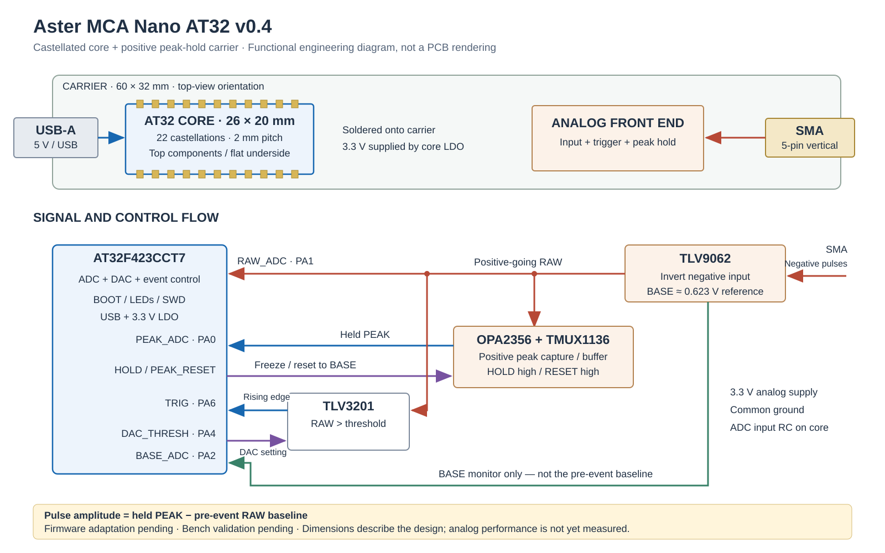

# Aster MCA Nano AT32 v0.4 — Castellated Core and Peak-Hold Carrier

Design date: 2026-11-12. This revision separates a **26 × 20 mm AT32 core** from a **60 × 32 mm analog carrier**. The core mounts through 22 castellated pads. The carrier provides a USB-A male connector, a five-pin through-hole SMA receptacle footprint, and optional G-S-G wire pads.

The input is an already amplified/shaped negative detector pulse. The design does not include a detector, PMT high-voltage supply, or charge-sensitive preamplifier. A peak-hold circuit retains the pulse height for later ADC conversion. RAW, PEAK, BASE, comparator triggering, and MCU control signals remain available for diagnosis and baseline correction.

## Design

- AT32F423CCT7 core, 2-layer / 1.6 mm PCB; 22 holes, 0.8 mm diameter, 2 mm pitch.
- TLV9062 inverting input stage, approximately −1 gain, AC coupling; nominal reference 0.623 V.
- OPA2356 peak detector/buffer, BAS316 capture diode, BAS70-04 anti-saturation diode, 470 pF C0G storage capacitor, and TMUX1136 control switch.
- TLV3201 comparator with DAC threshold and rising-edge trigger.
- Two blue 0603 LEDs with 1 kΩ series resistors.
- USB 5 V feeds the core's 3.3 V regulator and both boards. Do not drive its 3.3 V output from a second supply.

The initial bench-test range is 0.1–0.8 V negative pulses of approximately 4 µs total duration, into an approximately 49.9 kΩ input. It is not an accepted product specification. The analog common-mode range is more restrictive than the ADC's full supply range.

## Artifacts and status

`native/core/` and `native/carrier/` contain EasyEDA Pro projects, schematic PDFs, and netlists. `hardware/` contains the corresponding KiCad sources, custom footprints, previews, and candidate prototype Gerber/drill exports. `design/` contains electrical inputs, BOMs, and the interface contract. See [release status](docs/RELEASE-STATUS.md) for exact checks, exceptions, and native project links; see [assembly](docs/ASSEMBLY.md) for the top-view pin numbering and connector limitations.

Project names retain `NOT_FOR_FAB` to distinguish this untested hardware revision from the earlier measured v0.3 board. The included CAM data is for engineering review of a prototype, not an electrically qualified production release. Castellated-hole processing and the actual purchased connector dimensions must be confirmed. Never combine layers from the two different CAM exporters for one board.

The BOM is a per-reference design table. Core J1 represents the PCB castellations; carrier M1 is the core module built from this project; J3 is a wire-pad option. These are not separate connector/MCU purchases. Do not populate DNP entries by default.

## Firmware and validation

The old v0.8.2 firmware is not a drop-in implementation for this hardware. This delivery specifies, but does not implement or flash, the new acquisition state machine: pre-event RAW baseline capture, a non-retriggerable acquisition window, HOLD, PEAK readout, RESET, pileup handling, and explicit live/dead-time accounting. Amplitude is `PEAK − pre-event RAW baseline − calibrated pedestal`. BASE monitors the reference; it is not a substitute for the event baseline.

Selected 4 µs sin² simulations produced approximately +0.139% to +0.393% amplitude error, while sharp triangular cases reached approximately +11.05%. Vendor amplifier models and simplified diode/switch models were used. Switch charge injection, complete board parasitics, noise, and actual ADC kickback remain unverified. No improvement in measured energy resolution is claimed.

Bench validation must check settling, ringing, hold droop, reset pedestal, pulse-shape dependence, and rate-dependent baseline changes before a same-detector spectrum comparison. See [electrical review](docs/electrical-review.md) for the proposed timing and acceptance sequence.

Original project content uses the Aster-MCA Nano MIT license. Third-party datasheets and models retain their own licensing; vendor models are not redistributed under MIT in this delivery. Standard footprints originate from the KiCad community libraries under [CC-BY-SA 4.0 with the electronic-design exception](https://www.kicad.org/libraries/license/), which permits project-specific licensing of designs using the library data.
