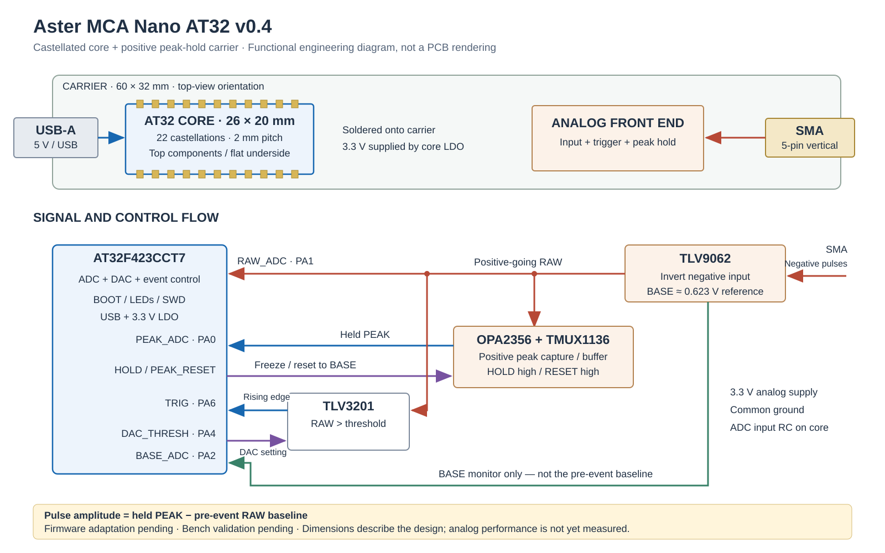

# Aster MCA Nano AT32 v0.4 — 邮票孔核心与峰值保持底板

设计日期：2026-11-12。此版本是一套新硬件原型：26 × 20 mm 的 AT32 核心模块，通过两排共 22 个邮票孔焊在 60 × 32 mm 峰值保持底板上。底板保留 USB-A 公头、五针通孔 SMA 母座以及 G-S-G 焊线备选孔。

这套设计针对已有放大／整形器的负脉冲输出。它不包含探测器、PMT 高压或 CSA。硬件保持脉冲峰值，让 ADC 在峰后读取稳定电平；仍保留 RAW 波形、BASE 参考监测和比较器触发，以便调试和基线扣除。

## 文件入口

| 内容 | 路径 |
|---|---|
| 核心：立创 EDA 原生工程、原理图 PDF、网表 | `native/core/` |
| 底板：立创 EDA 原生工程、原理图 PDF、网表 | `native/carrier/` |
| 核心：KiCad PCB、工程、自定义封装、Gerber/钻孔 | `hardware/core/` |
| 底板：KiCad PCB、工程、自定义封装、Gerber/钻孔 | `hardware/carrier/` |
| 电气设计输入、接口、BOM | `design/` |
| 装配与半孔编号 | [docs/ASSEMBLY.md](docs/ASSEMBLY.md) |
| 电气复核、待实现固件时序、台架验收 | [docs/electrical-review.md](docs/electrical-review.md) |
| 独立几何复核 | [docs/independent-review.md](docs/independent-review.md) |
| 最终检查与原生工程链接 | [docs/RELEASE-STATUS.md](docs/RELEASE-STATUS.md) |
| 仿真结果及边界 | `simulation/` |

工程名保留 `NOT_FOR_FAB`，用于区分未经实物验证的新设计与原 v0.3 的实测板。附带 Gerber 是供工程核对的样机候选数据，不是已有性能保证的量产版本；制造前尤其要确认半孔工艺和实购连接器尺寸。不要混用两个工具生成的同一块板的 Gerber 层。

BOM 为逐位号设计表。核心 `J1` 是 PCB 自身的邮票孔，不购买连接器；底板 `M1` 是本项目核心模块，不重复采购 MCU；底板 `J3` 是可直接焊线的孔。`DNP=True` 的 SW2/C101/C103 等不默认装配。

## 电路与接口

| 项目 | 当前设计 |
|---|---|
| MCU | AT32F423CCT7，LQFP-48；26 × 20 mm 核心，2 层、1.6 mm |
| 邮票孔 | 22 个，Ø0.8 mm，2 mm 节距；编号按顶视图顺时针，见装配文档 |
| 供电 | USB 5 V → 核心 XC6206 3.3 V → 两板；不允许同时外部反向驱动 3.3 V |
| 负脉冲前端 | TLV9062，约 −1 倍反相；AC 耦合 33 nF / 49.9 kΩ |
| BASE 参考 | 43 kΩ / 10 kΩ 分压缓冲，3.3 V 供电时约 0.623 V |
| 峰值保持 | OPA2356、BAS316、BAS70-04、470 pF C0G、TMUX1136 |
| 触发 | TLV3201 比较正向 RAW 与 DAC 阈值，TRIG 上升沿 |
| ADC 输入 | PEAK、RAW、BASE 三通道；BASE 不是事件前真实基线 |
| 上电控制 | HOLD=1、RESET=1，上拉使默认状态为隔离输入并复位 |
| 指示灯 | 两颗蓝色 0603 LED，分别通电／运行，均用 1 kΩ |

初始验证范围为约 **0.1–0.8 V 负脉冲、4 µs 总宽**。这是台架测试范围，不是已验收的产品指标。输入约 49.9 kΩ，不是 50 Ω；发生器幅度应按实际高阻负载核对。高速运放并非轨到轨输入，不能以 ADC 的 3.3 V 满量程推断整个前端允许 3.3 V 脉冲。

## 固件边界

原 v0.8.2 固件不能不改直接用于这块新板。本次交付完成硬件设计和时序要求，没有烧写固件或操作现有板子。

需要实现：RAW 事件前基线缓存、首个 TRIG 的定时捕获窗口、HOLD 冻结、PEAK 多次读取、RESET、堆积拒绝与活时间／死时间统计。幅度计算为 `PEAK − 事件前 RAW 基线 − 经标定的固定偏移`。2048 道是分箱数，不代表额外 ADC 位数。具体安全默认和起始延时见电气复核文档。

## 仿真能说明什么

在选定运放宏模型和简化开关／二极管模型下，4 µs 的 sin² 脉冲模型误差约 +0.139%～+0.393%；更尖的三角脉冲最坏约 +11.05%。这些结果用于筛选电路，不能据此承诺任意 4 µs 脉冲均有 1% 精度，更不能承诺能谱分辨率改善。

实板必须检查开关注入、保持下垂、反馈振铃、参考／事件基线差异和重复脉冲恢复。然后用同一探头、设置、源位置和相同活时间，对照原 Nano 与新峰保模式。仍需保留未平滑的谱和原始波形证据。

## 许可与来源

本项目新增原创设计、脚本和说明随 Aster-MCA / Nano 使用 MIT 许可。供应商文档和仿真模型不被重新授权为 MIT；交付包仅收录结果与模型来源说明，第三方模型按其原许可另行取得。KiCad 标准封装源自 KiCad 社区库，按 [CC-BY-SA 4.0 及电子设计例外](https://www.kicad.org/libraries/license/)使用；此例外允许使用库数据的电路设计采用自己的许可。
