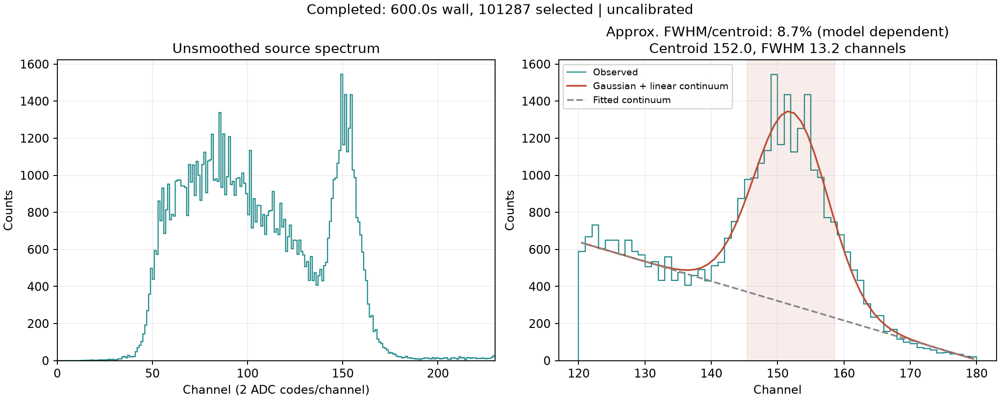
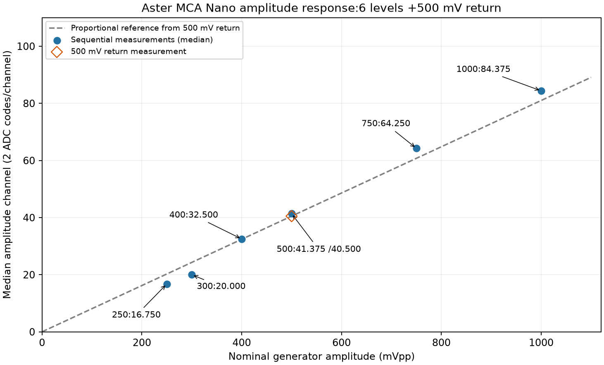
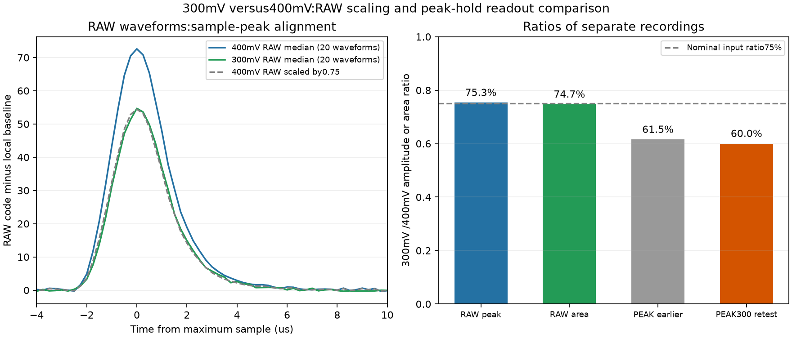
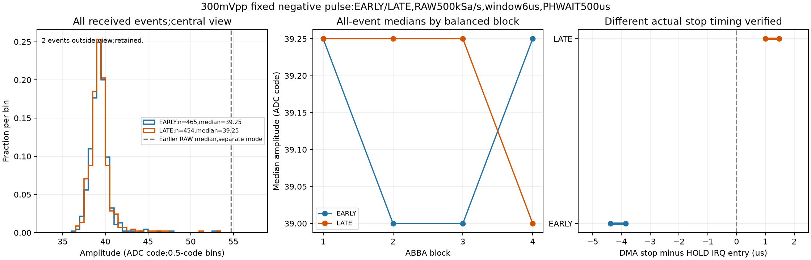

# AT32 peak-hold bench checkpoint — 2026-11-18

[中文](README.md) · [AT32 track](../../docs/at32/README.en.md) · [Firmware](../../firmware/at32-peakhold-fast7)

The v0.4.1 PTH core and peak-hold carrier have now produced electrical-pulse captures and Cs-137 spectra. **Amplitude-dependent low-level readout bias remains unresolved. The reported 8.67% is an uncalibrated channel-domain FWHM/centroid ratio, not a validated energy-resolution specification.** The measurements date from November 18; this publication checkpoint was assembled on November 19, 2026.

## Hardware and acquisition profile

Hardware: [v0.4.1 PTH core/carrier](../../hardware/at32-v0.4.1-pth/README.en.md), AT32F423CCT7, TLV9062, OPA2356, TMUX1136 and TLV3201. The measured assembly uses R104 = 49.9 kΩ, **one 10 kΩ R105 and a fitted 100 pF C101**; C102 remains 470 pF. These reworks differ from the frozen original candidate CAD.

Installed firmware is **0.4.1-fast.7**, 29,688 bytes, SHA-256 `e6a626ad15bb9c00f59dfa1767c5bcb3f14b45d59907700ba62f99f50eca4e2e`. CPU: 144 MHz; ADC clock: 72 MHz; internal LDO: 1.3 V. The bench profile is RAW 500 kSa/s, PEAK 24.5 cycles, EARLY, 6 µs capture window, 1 µs additional read delay and PHWAIT 500 µs. Boot defaults remain RAW 1 MSa/s, LATE and PHWAIT 10,000 µs; host tools explicitly configure experiments.

The host bins event batches into 2048 channels, **two ADC amplitude codes per channel**, using mean(PEAK1..4) minus the event-before RAW baseline. This is not a timed on-device histogram. The old v0.8.2 firmware and desktop UI belong to the archived v0.3 protocol and are not a compatible peak-hold interface. fast.6 is retained as the rollback image/source; other fast revisions are development history.

## Waiting deadline and 600-second Cs-137 record

Balanced complete acquisitions, six 30-second blocks per setting:

| Total-attempt deadline | Apparent FWHM/centroid | Selected events / wall second |
|---|---:|---:|
| 10 ms | 12.95% | 305.17 |
| 1 ms | 9.65% | 241.03 |
| 0.5 ms | 9.06% | 168.36 |

No narrow subgroup was selected retrospectively from old events. The subsequent approximately 600-second record at 0.5 ms received 102,346 events. Base quality selection retained 101,288; one additional conservative analog-range exclusion leaves **101,287 events** for the reported analysis.

Centroid: **152.012 channels**; FWHM: **13.173 channels**; ratio: **8.6658%**. Fit-window sensitivity is about 8.39–9.07%, and deviance/dof is 7.34, indicating model mismatch. There is no multipoint energy calibration, and the electrical-pulse tests show amplitude-dependent bias. These results do not establish intrinsic detector resolution or calibrated 662 keV energy resolution.

PHWAIT starts before preparation and includes reset release, ADC reads, DMA priming and waiting. It is neither a physical pulse interval nor a fixed per-event dead time. Internal armed-observed time includes capture and interrupt latency and has not been independently calibrated as true live time. Wall count rates are not absolute detection efficiencies.

## Electrical-pulse amplitude response

The OWON identified as AG1022 used [N61118A.bin](waveform/N61118A.bin): one negative sin² pulse, approximately 4 µs total width, 976.5625 Hz, High Z, offset −Vpp/2. The operator controlled its front panel while the Mac USB port connected to Nano. Voltages are nominal settings, not independently scope-measured values.

| Nominal input | Median amplitude, channels | Received events, about 5 s |
|---|---:|---:|
| 250 mVpp | 16.750 | 3,612 |
| 300 mVpp | 20.000 | 3,519 |
| 400 mVpp | 32.500 | 3,626 |
| 500 mVpp | 41.375 | 3,495 |
| 500 mVpp return | 40.500 | 3,522 |
| 750 mVpp | 64.250 | 3,446 |
| 1000 mVpp | 84.375 | 3,481 |

The 500 mV return differed by −2.1%; this repeatability difference must be considered when interpreting smaller sweep deviations. The 250/300 mV points scale nearly proportionally to each other, whereas 400 mV is closer to proportional scaling from the 500 mV return. These nominal settings are not an energy calibration or proof of a particular faulty component. Flagged records remain in raw data and follow the existing main-spectrum selection; there were no additional amplitude-tail cuts.

## RAW versus peak-hold readout

Each level has twenty discontinuous 4096-point RAW snapshots at 4 MSa/s, 1.024 ms each, with the same local-baseline estimator:

| Measurement | 300 mV | 400 mV | Ratio |
|---|---:|---:|---:|
| Median RAW peak, ADC codes | 54.7 | 72.6 | 75.3% |
| Median RAW area, code·µs | 148.36 | 198.58 | 74.7% |
| Median PEAK amplitude, ADC codes | 39.0, current recheck | 65.0, preceding record | 60.0% |

RAW peak and area closely track the nominal 75% input ratio. An immediate five-second PEAK recheck at 300 mV still returned only 39 codes. This directs attention toward the hold, trigger and readout chain, but **no specific root cause has been established**. These are different events and different acquisition modes, not simultaneous two-channel observations. Switching transients, loop settling and reset/hold behavior remain hypotheses.

## Actual EARLY/LATE comparison

After the signal was restored, four balanced EARLY/LATE/LATE/EARLY blocks produced sixteen batches of 128 attempts. EARLY received 465 events and LATE 454. **Both all-event medians were 39.25 codes.** Existing quality selection gives 39.00 and 39.25 codes, respectively.

Internal timestamps verify that EARLY completed the stop about 3.85–4.38 µs before HOLD IRQ entry, while LATE completed it about 1.00–1.48 µs afterwards. These are not externally measured hardware-edge timestamps. The actual timing changed, but low-amplitude readout did not recover. This does not exclude every form of ADC coupling.

Attempt-01 had no input signal: zero triggers and only RAW noise. It is retained separately. The operator rechecked/re-enabled the output before successful attempt-02; failed and valid comparisons have not been combined.

## Saved state and pending work

At the end of the bench session the operator confirmed generator output OFF. A subsequent approximately one-second check had zero triggers. The saved profile is fast.7, EARLY, RAW 500 kSa/s, PEAK 24.5 cycles, PHWAIT 500 µs, HOLD/RESET = 1/1, fault = 0 and self-test = 15. Hardware was not accessed during publication.

Pending: balanced 2/4/6/10 µs capture-window tests at 300 mVpp/−150 mV, and simultaneous scope observation of RAW and the **buffered** PEAK output to distinguish incomplete acquisition from subsequent decay. Probe loading on the storage capacitor itself changes the circuit. These tests have **not** been performed.

## Archives and reproduction

- `awg-bench.zip`: amplitude/return captures, RAW signal/off-noise records, stop-timing comparisons and failed signal checks.
- `cs137-600s.zip`: full original source-spectrum frames, headers, histograms, fits and analysis-code snapshots.
- `wait-deadline-sweep.zip`: complete waiting-deadline comparison records.
- Browsable summaries and figures sit beside the archives; each archive has an internal `SHA256.json`.
- Public metadata replaces local absolute paths and USB identifiers. Binary ADC samples and waveform bytes are unchanged; original local captures were not edited.
- [Offline verification and reproduction](../../analysis/20261118/README.md). SDKs, compilers, Flash/options backups and virtual environments are excluded.

Project-authored material retains [MIT](../../LICENSE); [third-party terms](../../THIRD_PARTY_NOTICES.md) remain applicable.
