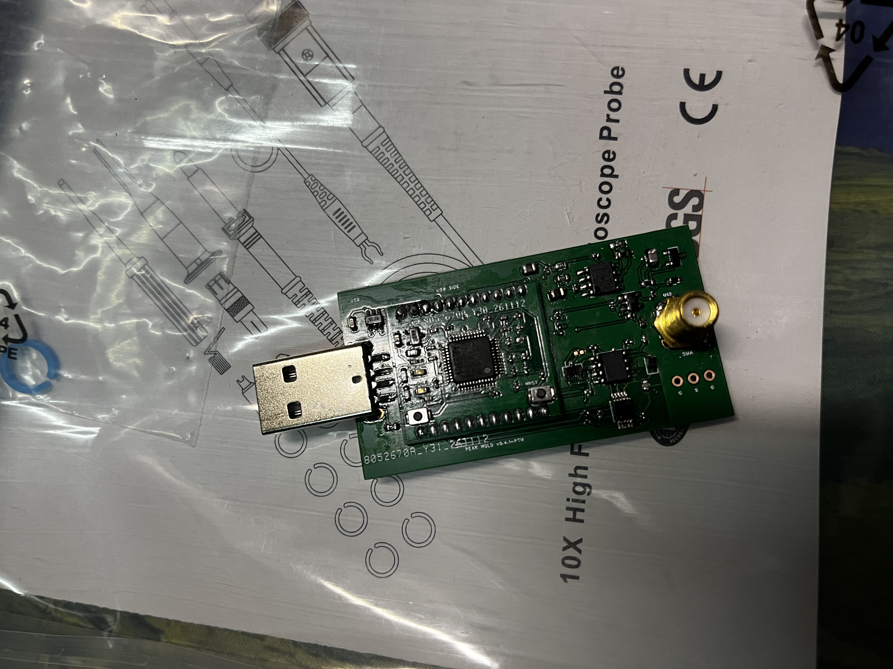
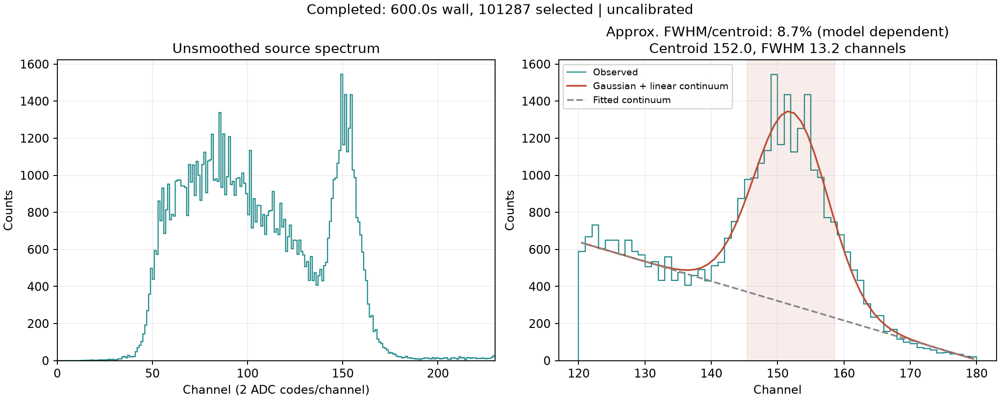
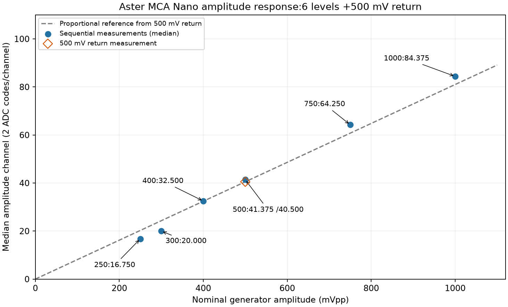
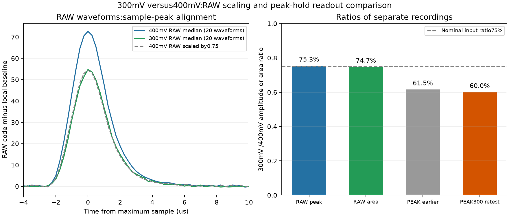
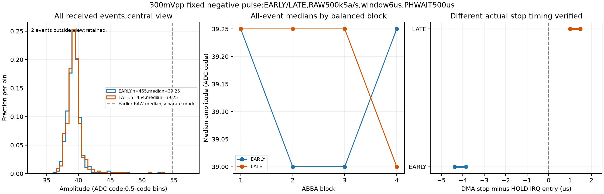
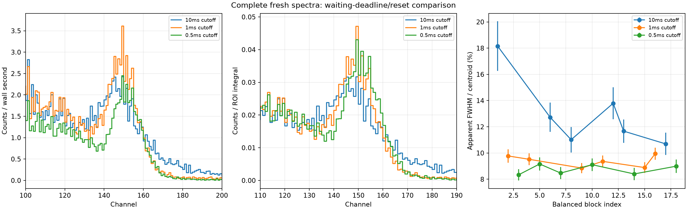
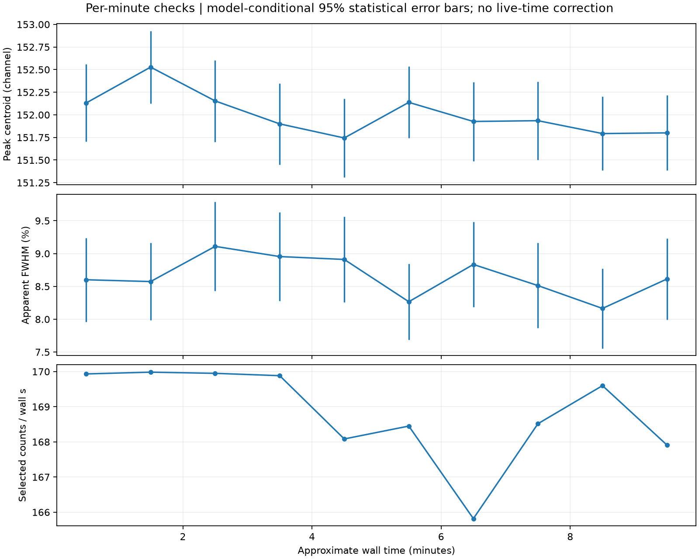
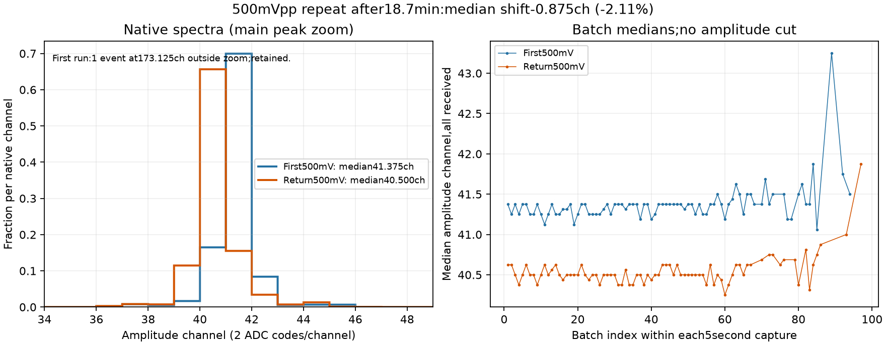

# AT32 峰值保持实验检查点 — 2026-11-18

[English](README.en.md) · [AT32 主线](../../docs/at32/README.md) · [固件源码](../../firmware/at32-peakhold-fast7)

本轮已经完成峰值保持底板与通孔核心板的实物读出、铯谱和固定脉冲诊断。**低幅输入的幅度映射问题尚未解决；8.67% 是未做能量标定的道数域 FWHM/峰位，不能作为已验证的能量分辨率。** 本检查点整理于 2026-11-19，实验记录日期为 2026-11-18。

[当前 BOM、定位图](../../docs/at32/peakhold-assembly/README.md) · [勘误与改焊](../../docs/at32/peakhold-assembly/errata.md) · [更多照片](../../README.md#at32-v041-实物bom-与测量)

## 实物与固件

- 硬件：[v0.4.1 普通通孔核心板与峰值保持底板](../../hardware/at32-v0.4.1-pth/README.md)，AT32F423CCT7、TLV9062、OPA2356、TMUX1136、TLV3201。
- 本次改焊：R104 = 49.9 kΩ，**R105 单颗 10 kΩ、C101 = 100 pF**。与原始候选制造文件中的模拟配置不同。C102 保持 470 pF。
- 固件：**0.4.1-fast.7**，CPU 144 MHz、ADC 时钟 72 MHz、内部 LDO 1.3 V；BIN 为 29,688 字节，SHA-256 为 `e6a626ad15bb9c00f59dfa1767c5bcb3f14b45d59907700ba62f99f50eca4e2e`。
- 实验参数：RAW 500 kSa/s、PEAK 24.5 周期、EARLY、6 µs 捕获窗、额外读前延迟 1 µs、PHWAIT 500 µs。
- 上电默认仍为 RAW 1 MSa/s、LATE、PHWAIT 10,000 µs。主机工具显式设置上述实验参数。
- 2048 道，每道 2 个 ADC 幅度码；幅度为四次 PEAK 均值减事件前 RAW 基线。本轮谱由电脑从批量事件分箱，**不是板上定时累计直方图**。

旧 v0.8.2 固件和原生桌面软件属于 v0.3 单板协议，不能直接当作本峰值保持协议的固件／上位机。fast.6 作为回退源码和二进制保留；其他 fast 版本为开发历史。

## 等待上限与十分钟铯谱

等待上限对照使用每档 6 × 30 秒、均衡交替的完整新采集，没有从旧数据中选择窄峰事件子集。

| PHWAIT | 表观 FWHM/峰位 | 入谱事件／墙钟秒 |
|---|---:|---:|
| 10 ms | 12.95% | 305.17 |
| 1 ms | 9.65% | 241.03 |
| 0.5 ms | 9.06% | 168.36 |

之后固定 0.5 ms，完成约 600 秒铯源记录：收到 102,346 个事件；基础质量选择后 101,288 个，再按保守模拟范围规则排除 1 个高幅记录，分析使用 **101,287 个事件**。

峰位 **152.012 道**，FWHM **13.173 道**，比值 **8.6658%**。改变拟合区间约得到 8.39%～9.07%；模型 deviance/dof = 7.34，存在明显模型失配。没有多点能量标定，固定脉冲又显示幅度相关偏差，因此这些值不能直接证明探测器本征分辨率或标定后的 662 keV 能量分辨率。

PHWAIT 从准备阶段开始，包含复位释放、ADC 读数、DMA 预采样和等待，不是物理脉冲间隔，也不是每个事件固定 0.5 ms 死时间。内部 armed-observed 时长包含捕获与中断延迟，未独立标定为真实活时间；墙钟计数率不可直接等同于绝对探测效率。

## 固定负脉冲幅度扫描

OWON 实际识别为 AG1022，使用 [N61118A.bin](waveform/N61118A.bin)：单个负向 sin² 脉冲，总宽约 4 µs，976.5625 Hz，High Z，偏置为 −Vpp/2。发生器由操作者面板控制，Mac 的 USB 接口连接 Nano。电压为仪器设定，未经示波器独立核对。

| 名义输入 | 幅度中位数／道 | 收到事件，约 5 秒 |
|---|---:|---:|
| 250 mVpp | 16.750 | 3,612 |
| 300 mVpp | 20.000 | 3,519 |
| 400 mVpp | 32.500 | 3,626 |
| 500 mVpp | 41.375 | 3,495 |
| 500 mVpp 回程 | 40.500 | 3,522 |
| 750 mVpp | 64.250 | 3,446 |
| 1000 mVpp | 84.375 | 3,481 |

500 mV 回程相差约 −2.1%，需纳入重复性判断。250/300 mV 两点彼此近似同比例，400 mV 更接近 500 mV 回程的比例；当前不能将名义电压曲线直接归因为某个器件或用作能量刻度。带标志事件保留在原始记录中，按原有规则不入主谱；没有额外按幅度去除尾部。

## RAW 与保持读数

分别抓取 20 段 4096 点、4 MSa/s RAW 快照；每段 1.024 ms，段间有空隙。使用相同局部基线方法后：

| 项目 | 300 mV | 400 mV | 比值 |
|---|---:|---:|---:|
| RAW 峰高中位数／ADC 码 | 54.7 | 72.6 | 75.3% |
| RAW 面积中位数／码·µs | 148.36 | 198.58 | 74.7% |
| 保持读数中位数／ADC 码 | 39.0，当前复测 | 65.0，先前记录 | 60.0% |

RAW 峰高、面积均接近名义输入比例 75%；保持读数偏离。300 mV 同设置补采 5 秒仍只有 39 码，差异复现。两路数据并非同一事件或同步双通道，且采样模式不同；证据支持优先检查保持、触发与读出链路，**尚未确定具体器件或根因**。开关瞬态、环路建立、复位／保持行为都是待验证假设。

## EARLY／LATE 停止时机对照

信号恢复后做了 4 组 EARLY/LATE/LATE/EARLY，共 16 批，每批 128 次尝试。EARLY 收到 465 个事件，LATE 454 个；**全部事件幅度中位数均为 39.25 码**。既有质量选择后分别为 39.00 和 39.25 码。

内部时戳确认 EARLY 在 HOLD 中断入口前约 3.85～4.38 µs 完成停止，LATE 在入口后约 1.00～1.48 µs 完成停止。这不是示波器测得的硬件边沿时间。切换实际执行，但没有恢复低幅读数；不能据此排除所有 ADC 耦合。

首次 attempt-01 输入缺失、0 触发，RAW 也仅见噪声；操作者重新开启并核对接线后才完成 attempt-02。失败记录单独保留，没有混入有效对照。

## 保存状态与下一步

实验结束时，操作者确认发生器输出关闭；随后约 1 秒检查为 0 触发。保存的配置为 fast.7、EARLY、RAW 500 kSa/s、PEAK 24.5 周期、PHWAIT 500 µs，HOLD/RESET = 1/1、fault = 0、自检 = 15。整理与推送期间没有重新访问硬件。

下一项待做：在 300 mVpp、−150 mV 下比较 2/4/6/10 µs 捕获窗口；如有示波器，同屏检查 RAW 与缓冲后的 PEAK 输出，区分未充到峰顶和充到后下降。不要把存储电容节点的探测负载误当成原电路行为。该窗口对照和同步示波器测量均**尚未执行**。

## 其余测量图

等待上限对照，具体采集口径见上文；墙钟计数率不是绝对探测效率。

同一十分钟记录的分段检查，用于观察峰位和计数随时间的变化。

500 mV 去程与回程对照，中位数相差约 −2.1%。

## 文件与离线复核

- `awg-bench.zip`：幅度扫描、回程、RAW 信号／输出关闭噪声、停止时机试验及失败检查的完整记录。
- `cs137-600s.zip`：600 秒源谱的原始帧、头、谱、拟合与分析代码快照。
- `wait-deadline-sweep.zip`：等待上限交替对照的原始帧及结果。
- 外层摘要和 `plots/` 便于直接浏览；归档内部 `SHA256.json` 校验各文件。
- 公共元数据替换了本机绝对路径与 USB 标识；所有二进制采样与波形文件保留原字节。原始本地记录未修改。
- [离线校验和复现说明](../../analysis/20261118/README.md)。本目录不含 SDK、编译器、Flash／选项字节备份或虚拟环境。

授权沿用 [MIT](../../LICENSE) 与[第三方条款](../../THIRD_PARTY_NOTICES.md)。
